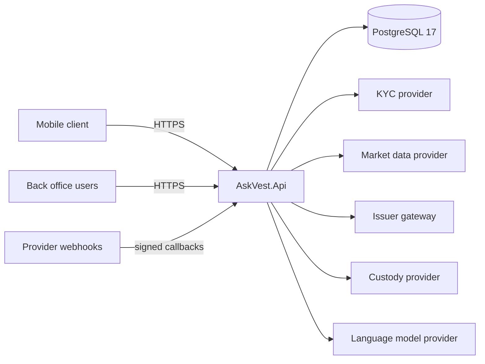

# 00. System Overview

## Product intent

AskVest lets Africans learn about, practice and invest in tokenized stocks and ETFs through an AI assistant. Users build knowledge through lessons, practice with virtual credits, then move to real investing when eligible. Payments, bill pay, remittances and merchant acceptance are out of scope. Stablecoins exist only to serve investing flows (funding and settlement).

## Architecture

Modular monolith: one deployable API, one PostgreSQL database. Modules are vertical slices under `src/Modules/AskVest.Modules.<Name>` sharing the platform kernel. Chosen for a small team: one deployment, one transaction boundary story, no distributed-systems cost. See ADR 0001.

## Module map

| Module | Phase | Owns |
|---|---|---|
| Identity | 1 | users, credentials, sessions, devices, PIN |
| Compliance | 2 | country eligibility, KYC state, consents, mode switch |
| Ledger | 3 | accounts, journal entries, balances (Practice and Real books) |
| Catalog | 4 | companies, tokens, issuers, rights and risk disclosures |
| MarketData | 5 | prices, candles, freshness labels |
| Practice | 6 | virtual credits, simulated orders |
| Learning | 7 | lessons, quizzes, streaks |
| Portfolio | 8 | holdings, cost basis, watchlist |
| Assistant | 9 | AI chat, tool calls, citations, audit |
| Trading | 10 | quotes, real orders, order state machine |
| Wallets | 11 | custody abstraction, addresses, signing requests |
| Funding | 12 | deposits, conversion, withdrawals |
| Notifications | 13 | channels, alerts, preferences |
| Earn | 14 | opt-in positions, yield sources |
| BackOffice | 15 | admin, audit log, reconciliation, feature flags |

## Module rules

- Modules talk only through a `Contracts` namespace (interfaces and DTOs) and integration events delivered through the outbox (Phase 3).
- No module reads another module's tables. Cross-module references are by id, checked in application code and reconciliation. No cross-module database foreign keys.
- Each module owns one schema plus the shared `platform` schema (see `02-data-standards.md`).

## Request pipeline

Order matters:

1. Forwarded headers (from configuration only)
2. Correlation id
3. Request logging
4. Exception handler
5. Status code pages
6. Security headers
7. HSTS (non-development)
8. Request timeouts
9. Rate limiter
10. CORS
11. Authentication and authorization (Phase 1)
12. Idempotency
13. Endpoint

Early positions normalize identity and errors; late positions (rate limit, CORS, idempotency) run after headers are settled so rejections still carry the envelope and correlation id.

## Transactions

One command handler equals one database transaction at Read Committed unless a phase documents otherwise. Phase 3 decides row locking versus serializable for balance changes.

## Practice versus Real

Separate route groups `/api/v1/practice/...` and `/api/v1/real/...`, separate ledger books, separate authorization. Confirmed in Phases 2 and 6. A client can never confuse them.

## Non-goals and undecided product statuses

Payments, remittances, merchant acceptance. Undecided until later phases: launch countries, issuers, chain, custody provider, fee model.
