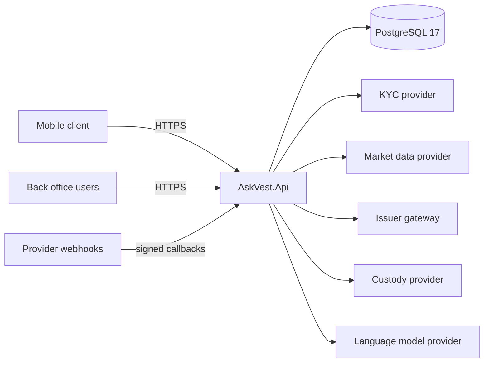

# 00. System Overview

## Product intent

AskVest lets Africans learn about, practice and invest in tokenized stocks and ETFs through an AI assistant. Users build knowledge through lessons, practice with virtual credits, then move to real investing when eligible. Payments, bill pay, remittances and merchant acceptance are out of scope. Stablecoins exist only to serve investing flows (funding and settlement).

## Architecture

Modular monolith: one deployable API, one PostgreSQL database. Modules are vertical slices under `src/Modules/AskVest.Modules.<Name>` sharing the platform kernel. Chosen for a small team: one deployment, one transaction boundary story, no distributed-systems cost. See ADR 0001.

## Module map

| Module | Phase | Owns |
|---|---|---|
| Identity | 1 | users, credentials, sessions, devices, PIN |
| Compliance | 2 | country eligibility, KYC state, consents, mode switch |
| Ledger | 3 | accounts, journal entries, balances (Practice and Real books) |
| Catalog | 4 | chains, issuers, instruments, tokens, rights and risk disclosures |
| MarketData | 5 | prices, candles, freshness labels |
| Practice | 6 | virtual credits, simulated orders |
| Learning | 7 | lessons, quizzes, streaks |
| Portfolio | 8 | holdings, cost basis, watchlist (read-only replay over the ledger) |
| Assistant | 9 | AI chat, tool calls, citations, audit |
| Trading | 10 | quotes, real orders, order state machine |
| Wallets | 11 | custody abstraction, addresses, signing requests |
| Funding | 12 | deposits, conversion, withdrawals |
| Notifications | 13 | channels, alerts, preferences |
| Earn | 14 | opt-in positions, yield sources |
| BackOffice | 15 | admin, audit log, reconciliation, feature flags |

## Module rules

- Modules talk only through a `Contracts` namespace (interfaces and DTOs) and integration events delivered through the outbox (Phase 3).
- No module reads another module's tables. Cross-module references are by id, checked in application code and reconciliation. No cross-module database foreign keys.
- Each module owns one schema plus the shared `platform` schema (see `02-data-standards.md`).

## Request pipeline

Order matters:

1. Forwarded headers (from configuration only)
2. Correlation id
3. Request logging
4. Exception handler
5. Status code pages
6. Security headers
7. HSTS (non-development)
8. Request timeouts
9. Rate limiter
10. CORS
11. Authentication and authorization (Phase 1)
12. Idempotency
13. Endpoint

Early positions normalize identity and errors; late positions (rate limit, CORS, idempotency) run after headers are settled so rejections still carry the envelope and correlation id.

## Transactions

One command handler equals one database transaction at Read Committed unless a phase documents otherwise. Phase 3 decides row locking versus serializable for balance changes.

## Practice versus Real

Separate route groups `/api/v1/practice/...` and `/api/v1/real/...`, separate ledger books, separate authorization. Confirmed in Phases 2 and 6. A client can never confuse them.

## Catalog chain-agnostic rules

The product is multi-chain and provider research is still open, so the catalog assumes nothing about a specific chain, issuer or provider.

- Chains are identified by CAIP-2 ids and carry a family (`evm`, `svm`, `move`, `other`). Every chain has exactly one family.
- Tokens are identified internally by UUIDv7 and externally by CAIP-19 asset ids computed from chain, token standard and canonical address. CAIP-19 is computed, never supplied.
- Addresses are canonical strings produced by the chain family handler, never numbers. EVM uses the EIP-55 checksum form.
- The chain family handler is the only seam that knows chain details: address validation and canonicalization, identifier parsing and building, explorer links. EVM-specific library types may appear only inside the EVM handler (architecture test).
- Adding a chain family means: implement `IChainFamilyHandler` for the family, register it in `AddCatalogModule` next to `EvmChainFamilyHandler`, and add chains to the data files with that family. No schema change is needed: addresses are stored as canonical text, decimals are capped at 18 for every family, and identifiers are CAIP strings produced by the handler.
- Each token maps to exactly one ledger asset with an explicit immutable code, registered with kind `token` and scale equal to the token's decimals (at most 18).
- Practice trades instruments; Real trades tokens. Availability is computed per instrument for Practice and per token for Real.
- Catalog content comes from reviewed versioned data files imported idempotently at deploy time. The API only reads; the application role has select-only access.
- Once a token has ever been listed, its chain, address, decimals, issuer, instrument and ledger asset code can never change. Removal means `delisted`; rows are never deleted.
- Selling is never blocked by an expired review or a country change: users must always be able to exit.
- Each token carries a free-form gateway key naming the execution adapter that will handle it (Phase 10). It is required for listing, stored, never exposed by the API, and no adapter is assumed.
- The repository ships no real catalog data. Sample data is fictional, lives in a separate folder and loads only when `Catalog:LoadSampleData` is true; the importer refuses it in Production.

## Market data rules

MarketData keeps the latest reference price of every active catalog instrument in its own schema. A hosted poller is the only caller of the provider for latest prices; request handlers read the database and never call the provider. Candles are fetched on demand only to fill the cache, under single-flight. Every price carries source, `as of`, age, session and a freshness label (`live`, `delayed`, `closed`, `halted`, `stale`, `unavailable`) plus `usableForExecution`. Consumers must honor `usableForExecution` and must never execute on `stale`, `halted` or `unavailable` prices. The module mentions instruments only; tokens and chains are never referenced.

## Practice rules

Practice trades instruments, never tokens, so it stays valid however the multi-chain research ends. Practice cash is USD in the ledger practice book; each traded instrument gets a practice ledger asset coded `P.` plus the instrument symbol in uppercase, scale 6, mapped in `practice_instruments` on first use. The `P.` prefix is reserved: the Catalog importer rejects any real token ledger asset code starting with it. Practice supports only instruments whose catalog quote currency is USD. Orders fill at the latest Market Data price and only when `usableForExecution` is true; a simulated fee (configurable basis points, default 0) goes to the system fees account. Practice reuses the real building blocks on purpose: the ledger practice book, the transaction scope, the outbox and the Market Data and Catalog contracts. Phase 10 extends the same order service for real trading instead of rewriting it.

## Learning rules

Learning exists to make users understand what they are buying, not to make them trade more. Content is versioned data files in the repository (tracks holding ordered lessons with body blocks and optional quizzes), loaded into an immutable in-memory snapshot at startup and validated with a banned-phrase lint; there are no content tables. Lesson and quiz reads never reveal correct options or explanations; only graded attempts do. Completion records the lesson version, and lessons flagged `requiredForReal` must be completed at their current version before Real eligibility passes (the `learning_required` blocker). Streaks count consecutive UTC days with learning activity only: never orders, logins, deposits or anything that moves money. The module references no ledger, practice, market data, trading, funding or compliance code; nothing in it touches money.

## Assistant rules

The assistant explains and researches; it never advises, never trades and never moves money. It has no write tools at all: every tool is read-only and server-scoped to the authenticated caller. Tools never take a user id; ownership comes from the server-side session context. Retrieved catalog and lesson text is untrusted data, never instructions. Every model output passes server-side checks (citation validation, numeric grounding, banned-phrase policy, sanitization) before a user sees it, and every exchange writes an audit event containing ids, tool names, hashes, usage and outcome only, never message text or raw tool results. The language model client is the only seam to a provider; the deterministic fake ships for development and tests and a real adapter is chosen only after evaluation.

## Non-goals and undecided product statuses

Payments, remittances, merchant acceptance. Undecided until later phases: launch countries, issuers, chain, custody provider, fee model.
