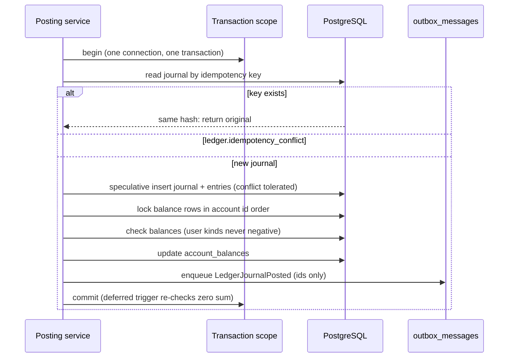
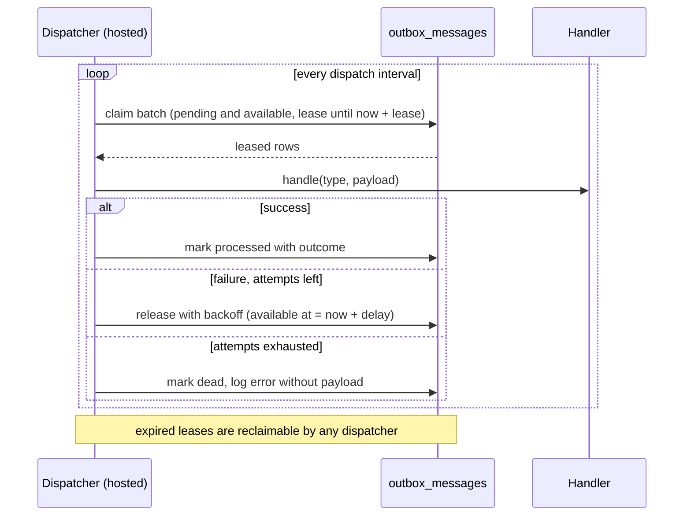

# 03. Money and Ledger Principles

Implemented in Phase 3 by the Ledger module (`src/Modules/AskVest.Modules.Ledger`,
schema `ledger`) plus the Platform transaction scope and outbox.

## Double entry

Every journal is one atomic movement; its entries are signed amounts on accounts.
For every asset in a journal the entries sum to exactly zero, enforced twice: the
application validates before insert and a deferred constraint trigger on
`journal_entries` re-checks at commit. A trade is at least two lines plus explicit
lines for fees, spreads and FX. Ledger rows are immutable: the `askvest_app` role
gets insert and select only on `journals` and `journal_entries`; corrections are
reversal journals, and a journal can be reversed at most once (unique link).

## Books

Two books: `practice` and `real`. Every journal, account, entry and balance
belongs to one book. The database enforces book consistency through composite
keys: an entry's account and journal share its book, and an entry's asset equals
its account's asset. Practice value can never reach a real account; this is
proven at service level and database level.

## Account kinds

`user_available`, `user_held` (funds reserved for pending orders or
withdrawals), `system_clearing` (counterparty for external movements),
`system_fees`, `system_practice_issuance` (source of virtual credits, practice
book only). User accounts can never go negative; the database forbids it via a
check on `account_balances` keyed by the copied `allow_negative` flag. System
accounts may go negative. User and system accounts are created lazily on first
use, relying on the unique constraint plus a follow-up read.

## Balances

Balances are maintained transactionally in `account_balances`, updated in the
same transaction as the entries under row locks. A balance row copies
`allow_negative` from its account at creation and never changes it. Balances
are never cached elsewhere and never appear in logs.

## Concurrency

Read Committed plus explicit row locks. Posting locks the balance rows of every
account in the journal in one deterministic order (sorted by account id) before
changing them. No serializable isolation and no automatic retries. A deadlock or
lock timeout surfaces as `service.unavailable`; the client retries with its
idempotency key.

## Idempotent posting

Every journal carries a unique idempotency key and a content hash. The same key
with the same content returns the original journal; the same key with different
content is `ledger.idempotency_conflict` (409). Inserts tolerate conflicts
without aborting the surrounding transaction (speculative insert plus read-back).
Callers build the ledger key from their own operation id (`module:operation:id`),
never straight from a client header unless prefixed with the user id.

## Precision

Amounts are `numeric(28,18)` in the database. Each asset has a scale (maximum
fractional digits). An amount with more fractional digits than the asset's
scale, a zero amount, or more than ten integer digits is rejected, never rounded.
Seeded assets: `USD` (scale 6, fiat) and `USDC` (scale 6, stablecoin). Other
modules register assets through the contract; registration is idempotent.

## Time

`posted_at` always comes from `TimeProvider`, never the database clock. History
orders by posted at, then journal id.

## No free text

Journals hold a reason code and a reference (module name and entity id), never
user-supplied text.

## Transactions across modules

Platform provides one transaction scope per request. All module contexts in the
same scope share one connection and one transaction. The endpoint commits
explicitly at the end; any failure rolls everything back, including outbox
enqueues. This lets later phases change their own tables, post to the ledger
and enqueue events atomically.

## Outbox

One table in the `platform` schema (`outbox_messages`), written inside the same
transaction as the business change. A hosted dispatcher claims a batch with a
time-limited lease (it does not hold a transaction open), runs in-process
handlers by message type, and marks messages processed. Delivery is at least
once, so handlers must tolerate duplicates. Failures retry with exponential
backoff up to a cap, then the message is marked dead and logged at error level.
An unknown message type is marked processed with outcome `no_handler`.
Processed messages are removed after a retention period; dead messages are
kept. Payloads carry ids only: no secrets, no amounts, no personal data, and
payloads and error fields never hold amounts, balances or account ids.

## Reconciliation

A hosted job pages through all accounts and checks each balance equals the sum
of its entries, and that the sum of all balances per book and asset is zero. A
mismatch is logged at error level with the account id and delta and never
auto-corrected. Provider balances and transactions are reconciled against
ledger state on a schedule (Phase 15 tooling); discrepancies create
reconciliation records, never silent adjustments.

## Audit

Stored for audit: journal entries with idempotency keys, account snapshots at
posting time, provider references, actor identity, and timestamps. Ledger rows
are retained even when personal data is anonymized.

## Journal patterns

Standard journal shapes. Phases 6, 10 and 12 build on these; debit lines are
positive amounts and credit lines negative on the same asset. Amounts balance
per asset.

| Pattern | Reason code | Lines |
|---|---|---|
| Practice credit grant | `practice_credit_grant` | debit `system_practice_issuance`, credit `user_available` |
| Deposit | `deposit` | debit `system_clearing`, credit `user_available` |
| Withdrawal | `withdrawal` | debit `user_available`, credit `system_clearing` |
| Hold | `hold` | debit `user_available`, credit `user_held` |
| Release | `release` | debit `user_held`, credit `user_available` |
| Buy fill | `trade_buy` | debit `user_held` cash, credit `system_clearing` cash; debit `system_clearing` asset, credit `user_available` asset; fee lines debit user, credit `system_fees` |
| Sell fill | `trade_sell` | mirror of buy fill |
| Fee | `fee` | debit paying account, credit `system_fees` |
| Reversal | `reversal` | exact mirror of the reversed journal |
| Adjustment | `adjustment` | explicit correction pairs, always with a reference |
| Practice order fill (buy) | `trade_buy` | USD: `user_available` pays cost plus fee, `system_clearing` receives cost, `system_fees` receives fee; asset: `system_clearing` gives quantity to `user_available` |
| Practice order fill (sell) | `trade_sell` | asset: `user_available` gives quantity to `system_clearing`; USD: `system_clearing` pays proceeds, `user_available` receives proceeds minus fee, `system_fees` receives fee |
| Practice stop hold | `hold` | asset: `user_available` to `user_held` |
| Practice stop release | `release` | asset: `user_held` back to `user_available` |
| Practice stop trigger | `trade_sell` | same lines as a sell fill, but the asset leaves `user_held` |
| Practice reset | `practice_reset` | every non-zero practice balance of the user back to the system accounts, then a fresh `practice_credit_grant` |

Practice asset codes start with `P.` (for example `P.NVDA`) and are registered lazily on first use with kind `token` and scale 6. The prefix is reserved: the Catalog importer refuses any real token ledger asset code starting with `P.` so practice value can never collide with a real asset.

## Posting transaction

## Outbox lease cycle

