# 04. State Machines

Rule for every machine: every transition is a method on the aggregate that returns `Result`. An illegal transition returns `business.rule_violated`. Every transition writes an audit event.

## Order

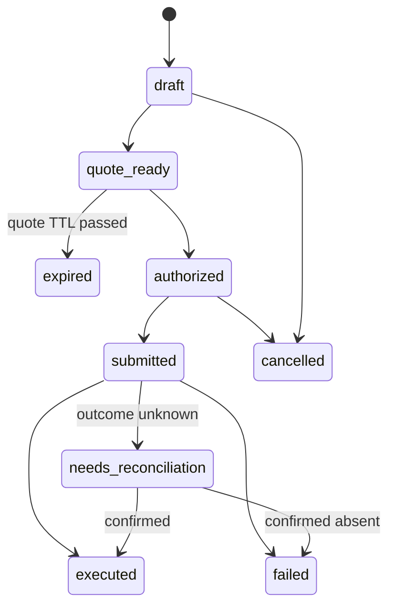

Invariants: submission and execution are separate states; an expired quote never silently becomes a new trade; terminal states are `executed`, `failed`, `cancelled`.

## Deposit

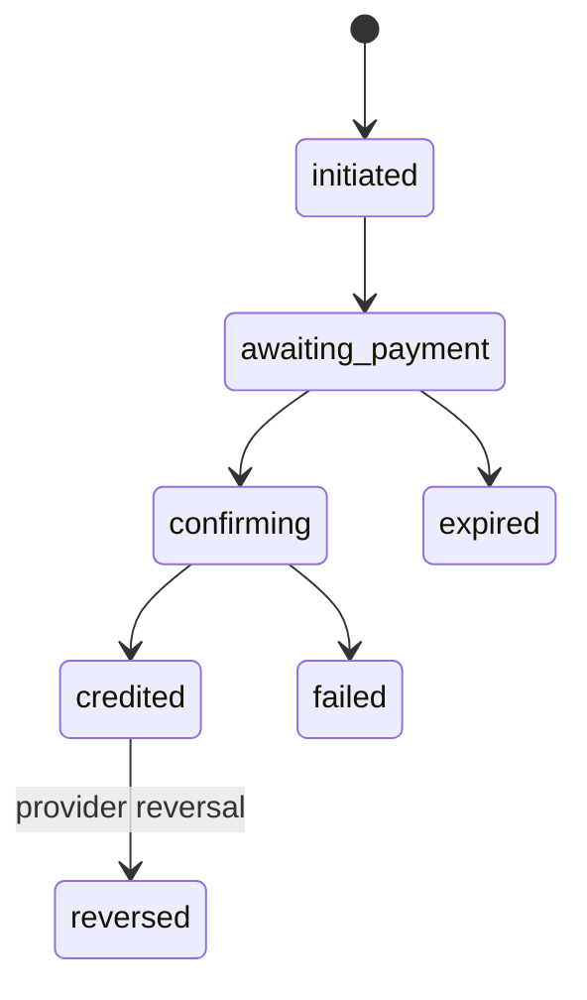

Terminal: `credited` (unless reversed), `failed`, `expired`.

## Withdrawal

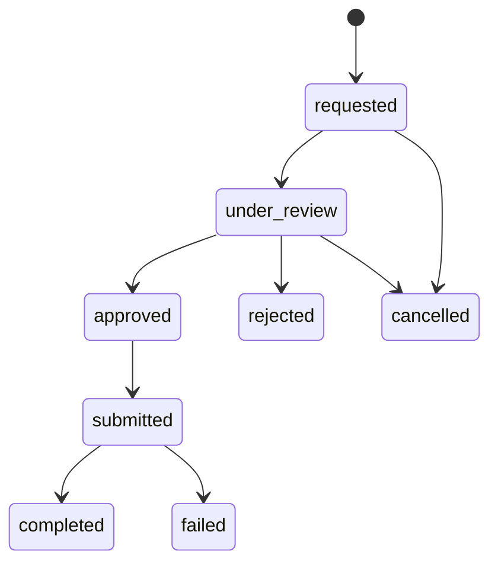

Terminal: `completed`, `failed`, `rejected`, `cancelled`.

## Eligibility

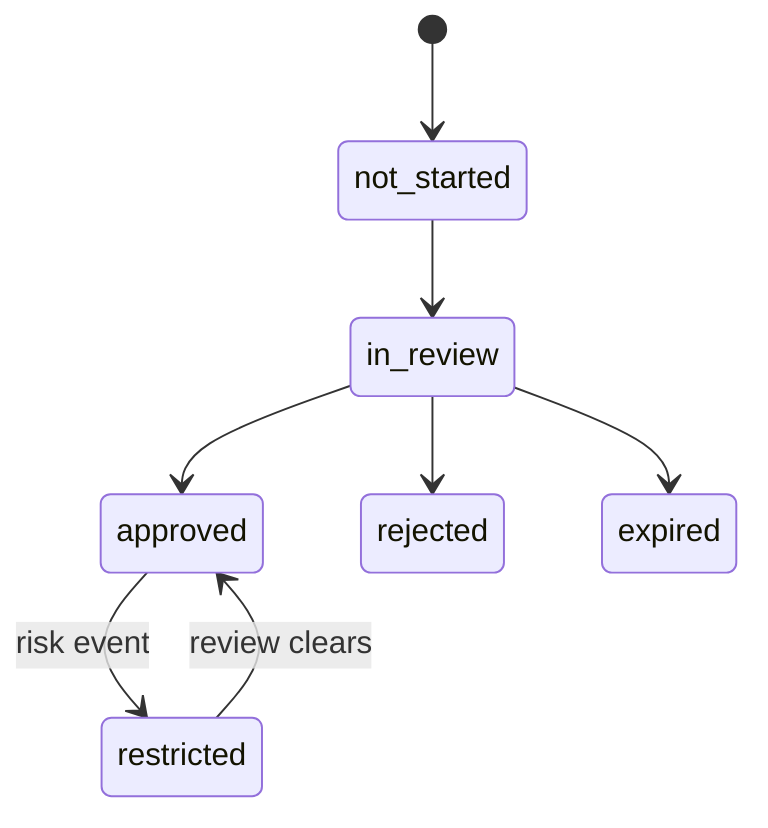

## Earn position

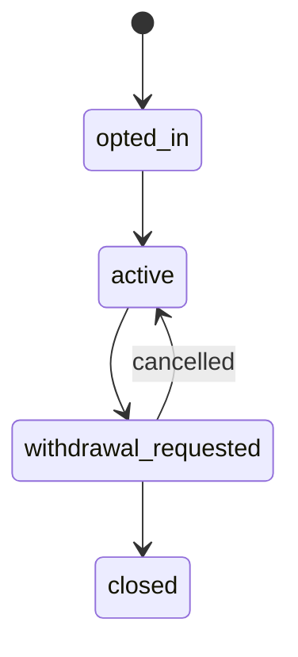

## Account mode

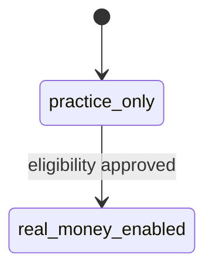

`real_money_enabled` is terminal in this model; demotion is handled as a restriction flow in Phase 2, not a silent flip.

## KYC verification (Compliance, Phase 2)

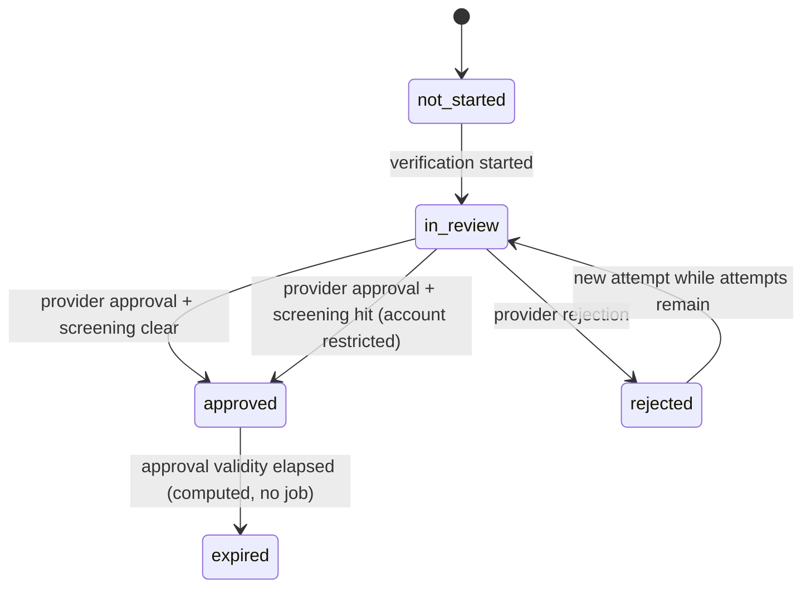

`kyc_status` on the compliance profile is `not_started`, `in_review`,
`approved` or `rejected`. Expiry is derived from the stored expiry time
against `TimeProvider`; there is no background job. Screening state is
`not_run`, `clear` or `hit`; a hit restricts the account for Real without
changing the KYC status.

## Identity state machines

- User: `pending_verification` to `active` on email code verification; `active` to `deletion_requested` on deletion request; `deletion_requested` to `anonymized` by the scheduled job; `active` to `disabled` by later admin tooling. `anonymized` is terminal.
- Session: created to `revoked` with a reason. Revocation is final.
- Device: created untrusted to `trusted` on first verified login or device code; `trusted` to `revoked`. Revoking a device revokes its sessions.
- One-time code: issued to `consumed` or `expired`; attempts increment atomically up to the cap. Single use.
- Step-up grant: issued to `consumed` or `expired`; 120 second life, single use.

## Catalog token (Catalog, Phase 4)

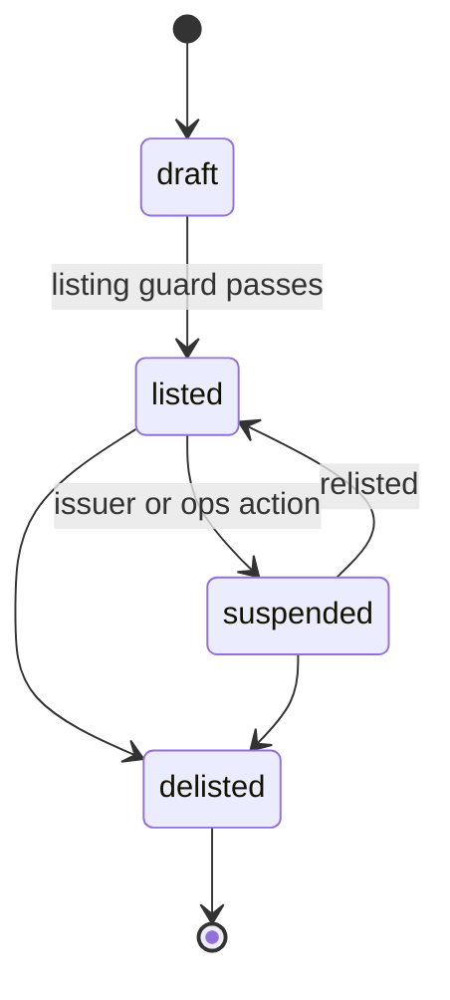

`delisted` is terminal: a returning token is a new token row. `ever_listed`
is set on first entry to `listed` and freezes the immutable fields (chain,
address, decimals, issuer, instrument, ledger asset code) forever after.
Sellers may still exit a `delisted` token when its chain is enabled and a
gateway key exists.

## Catalog issuer and instrument

- Issuer status is `approved` or `suspended` (review metadata lives on the row; expiry of the review blocks new listings, not exits).
- Instrument status is `active` or `delisted`; delisting an instrument hides it from Practice without touching token rows.

## Practice account and order (Practice, Phase 6)

The practice account has two states: `not_started` and `active`. `POST /account` moves `not_started` to `active` and grants the starting credits exactly once; a reset keeps the account `active`, zeroes every practice balance through journals and grants again under the reset policy (cooldown plus a rolling 30 day limit counted from `practice_events`).

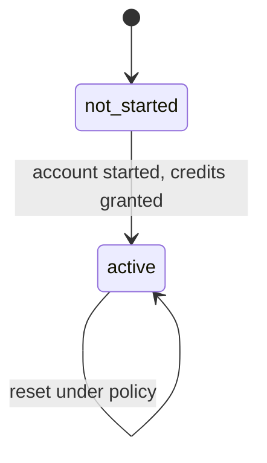

The practice order machine is deliberately simpler than the real one: market orders fill inside the request and never persist an `open` state; stop-loss orders are `open` until triggered or cancelled. Failures are errors, not stored orders.

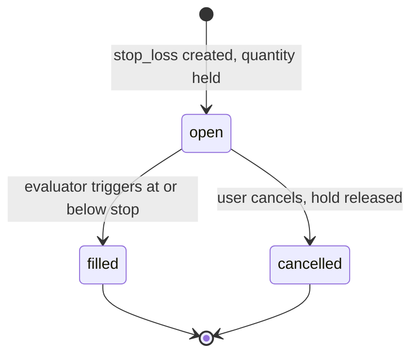

Phase 10's real order machine extends this shape with quote, authorization and submission states; the practice states and journal patterns carry over.

## Real quote and order (Trading, Phase 10)

A quote is a one-time offer: `open` until an order consumes it (`used`) or its expiry passes (expiry is computed from time, never stored as a state). A quote can create at most one order.

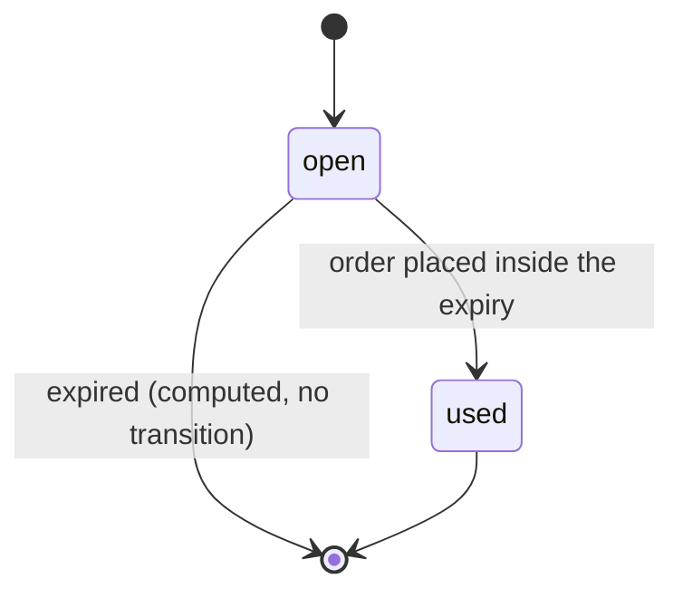

The real order separates submission from execution. Terminal states are `executed`, `failed` and `cancelled`; `needs_reconciliation` is non-terminal and keeps the reserved funds held until a definitive gateway answer arrives.

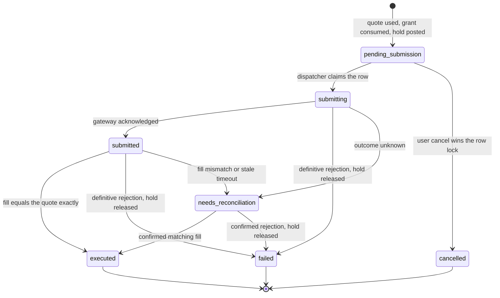

Transition table (anything not listed is illegal, logged and refused):

| From | To | Trigger |
|---|---|---|
| - | `pending_submission` | order insert inside the placement transaction |
| `pending_submission` | `submitting` | outbox dispatcher claims the order row |
| `pending_submission` | `cancelled` | user cancel while still unclaimed |
| `submitting` | `submitted` | gateway acknowledges with a reference |
| `submitting` | `failed` | gateway definitively rejects |
| `submitting` | `needs_reconciliation` | submit outcome unknown (timeout, lost connection) |
| `submitted` | `executed` | status poll reports a fill matching the quote |
| `submitted` | `failed` | status poll reports a definitive rejection |
| `submitted` | `needs_reconciliation` | fill mismatch, or `submitted` older than the timeout |
| `needs_reconciliation` | `executed` | status poll confirms a matching fill |
| `needs_reconciliation` | `failed` | status poll confirms a rejection |

Recovery without transitions: a `pending_submission` order stuck past the threshold is re-enqueued by the progress job; a `submitting` order stuck past the threshold is resolved by asking the gateway for the status by our key. "Not found" is never definitive: the order stays in `needs_reconciliation` and nothing is auto-released on uncertainty.

## Wallet deposit (Wallets, Phase 11)

A detected on-chain deposit is stored first and credited only when every rule passes. Terminal states are `credited`, `quarantined` and `ignored`; `pending` is non-terminal and retries.

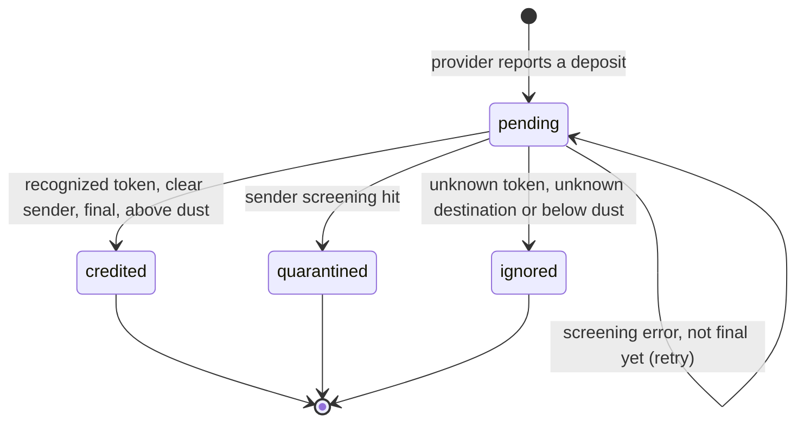

Transition table:

| From | To | Trigger |
|---|---|---|
| - | `pending` | deposit job stores a provider-reported deposit |
| `pending` | `credited` | all credit rules pass and the ledger journal posts once |
| `pending` | `quarantined` | sender screening returns a hit |
| `pending` | `ignored` | token unknown, destination not a user address, or amount below dust |
| `pending` | `pending` | screening error or finality not reached; retried next cycle |

Deposits to treasury addresses are never stored as user deposits. Crediting is keyed `wallet:deposit:<depositId>` so repeats and restarts cannot double-credit.

## Wallet withdrawal (Wallets, Phase 11)

A withdrawal mirrors the Phase 10 order machine: preview, bound step-up grant, reserve before send, submission separate from completion, and `needs_reconciliation` that never auto-releases.

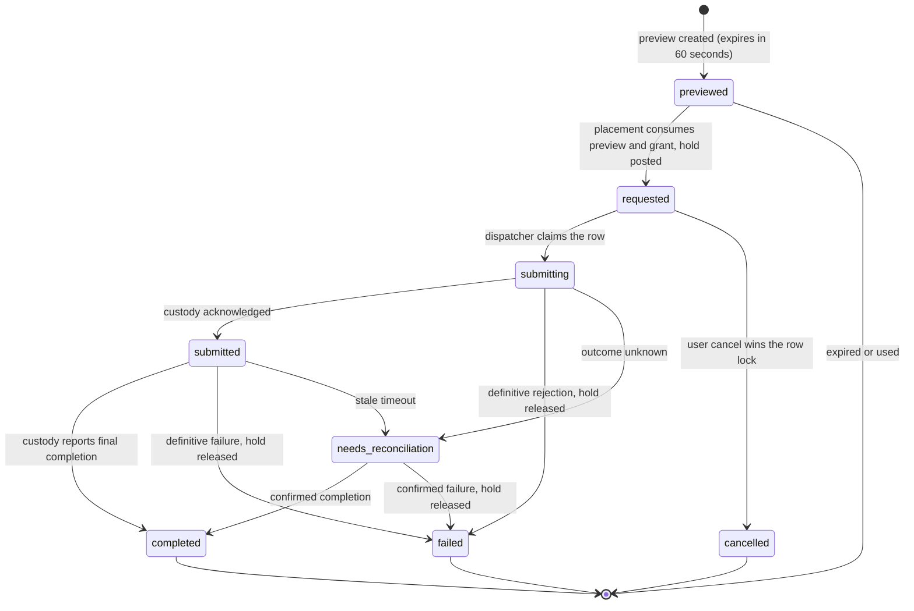

Transition table (anything not listed is illegal):

| From | To | Trigger |
|---|---|---|
| - | `previewed` | preview insert with expiry and terms hash |
| `previewed` | `requested` | placement inside one transaction: preview marked used, grant consumed, hold posted, submit message enqueued |
| `previewed` | `cancelled` | preview expiry job deletes it (no state kept) |
| `requested` | `submitting` | outbox dispatcher claims the row |
| `requested` | `cancelled` | user cancel while still unclaimed; hold released |
| `submitting` | `submitted` | custody acknowledges with a reference |
| `submitting` | `failed` | definitive rejection; hold released |
| `submitting` | `needs_reconciliation` | submit outcome unknown |
| `submitted` | `completed` | status poll reports completion after finality |
| `submitted` | `failed` | status poll reports definitive failure; hold released |
| `submitted` | `needs_reconciliation` | submitted older than the timeout |
| `needs_reconciliation` | `completed` | status poll confirms completion |
| `needs_reconciliation` | `failed` | status poll confirms failure; hold released |

Cancel is only legal in `requested`, before the dispatcher claims the row; any other state answers `resource.conflict`. "Not found" from the provider is never definitive. Ledger keys are `wallet:withdrawal:<id>:hold`, `:settle` and `:release`.
