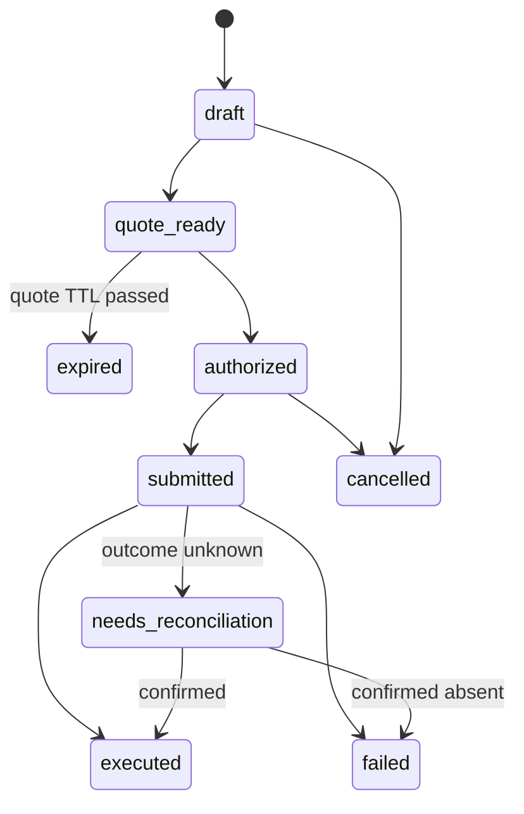
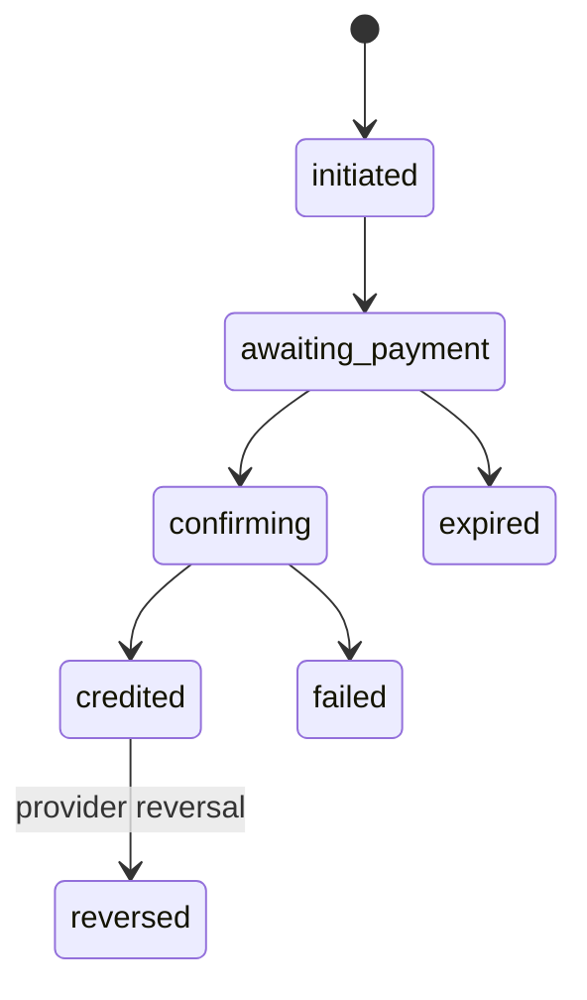
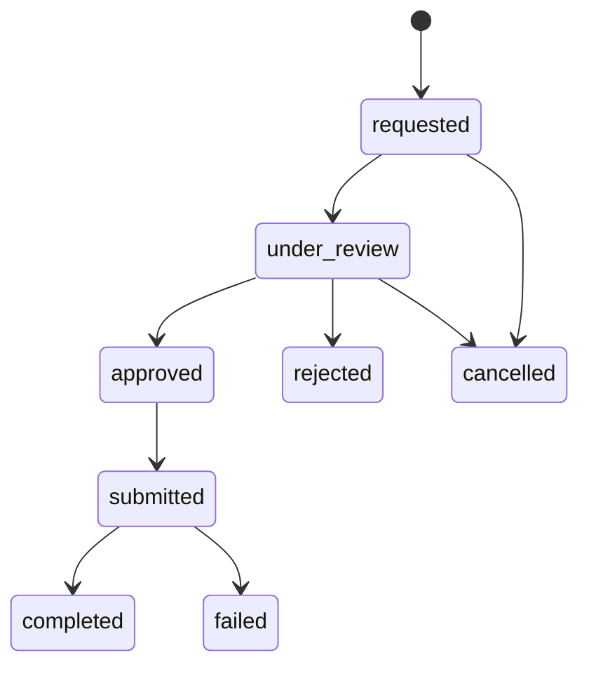
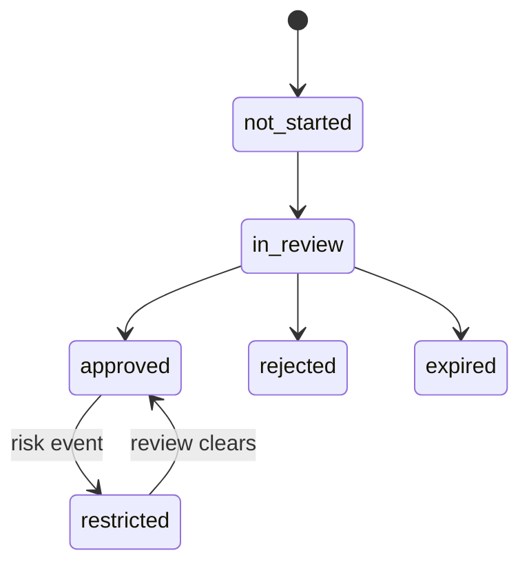
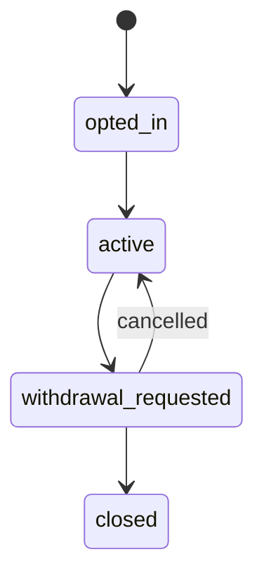
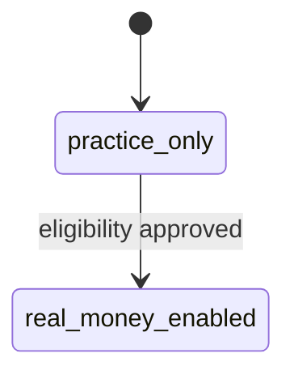
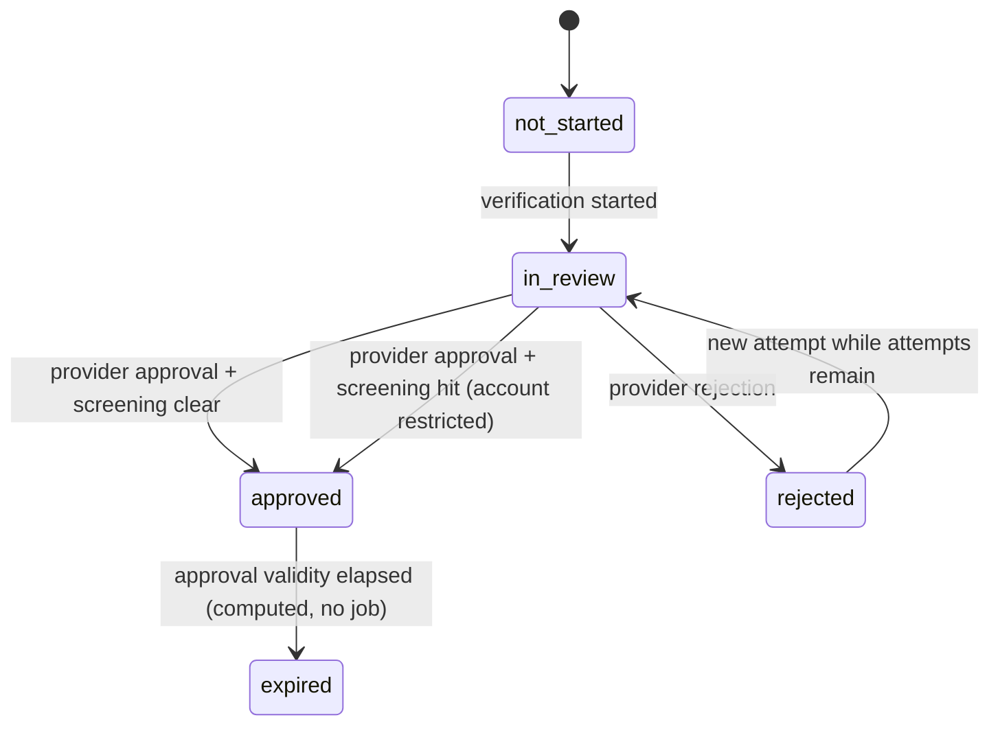

# 04. State Machines

Rule for every machine: every transition is a method on the aggregate that returns `Result`. An illegal transition returns `business.rule_violated`. Every transition writes an audit event.

## Order

Invariants: submission and execution are separate states; an expired quote never silently becomes a new trade; terminal states are `executed`, `failed`, `cancelled`.

## Deposit

Terminal: `credited` (unless reversed), `failed`, `expired`.

## Withdrawal

Terminal: `completed`, `failed`, `rejected`, `cancelled`.

## Eligibility

## Earn position

## Account mode

`real_money_enabled` is terminal in this model; demotion is handled as a restriction flow in Phase 2, not a silent flip.

## KYC verification (Compliance, Phase 2)

`kyc_status` on the compliance profile is `not_started`, `in_review`,
`approved` or `rejected`. Expiry is derived from the stored expiry time
against `TimeProvider`; there is no background job. Screening state is
`not_run`, `clear` or `hit`; a hit restricts the account for Real without
changing the KYC status.

## Identity state machines

- User: `pending_verification` to `active` on email code verification; `active` to `deletion_requested` on deletion request; `deletion_requested` to `anonymized` by the scheduled job; `active` to `disabled` by later admin tooling. `anonymized` is terminal.
- Session: created to `revoked` with a reason. Revocation is final.
- Device: created untrusted to `trusted` on first verified login or device code; `trusted` to `revoked`. Revoking a device revokes its sessions.
- One-time code: issued to `consumed` or `expired`; attempts increment atomically up to the cap. Single use.
- Step-up grant: issued to `consumed` or `expired`; 120 second life, single use.
