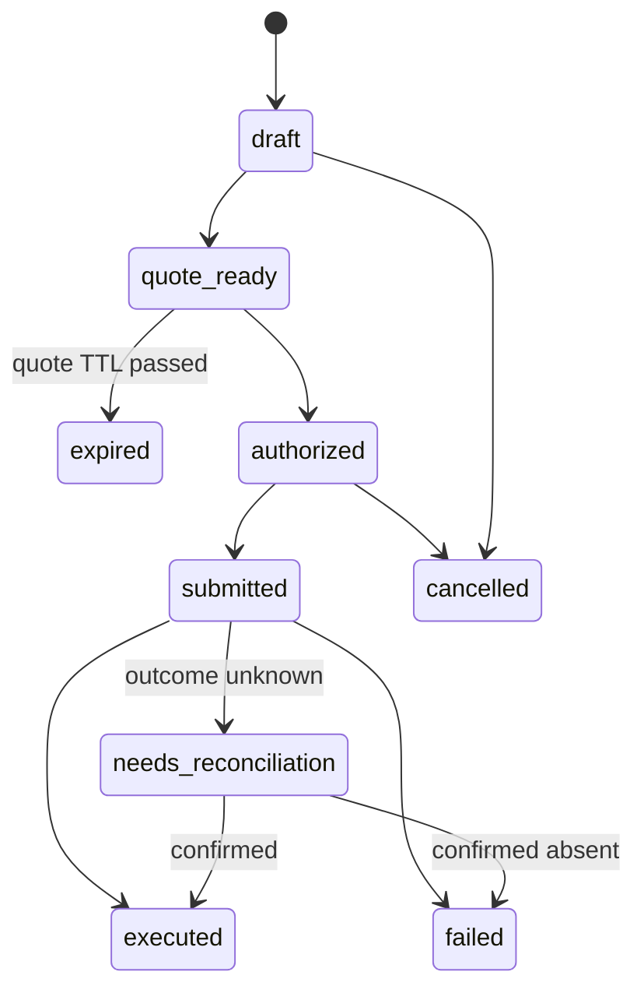
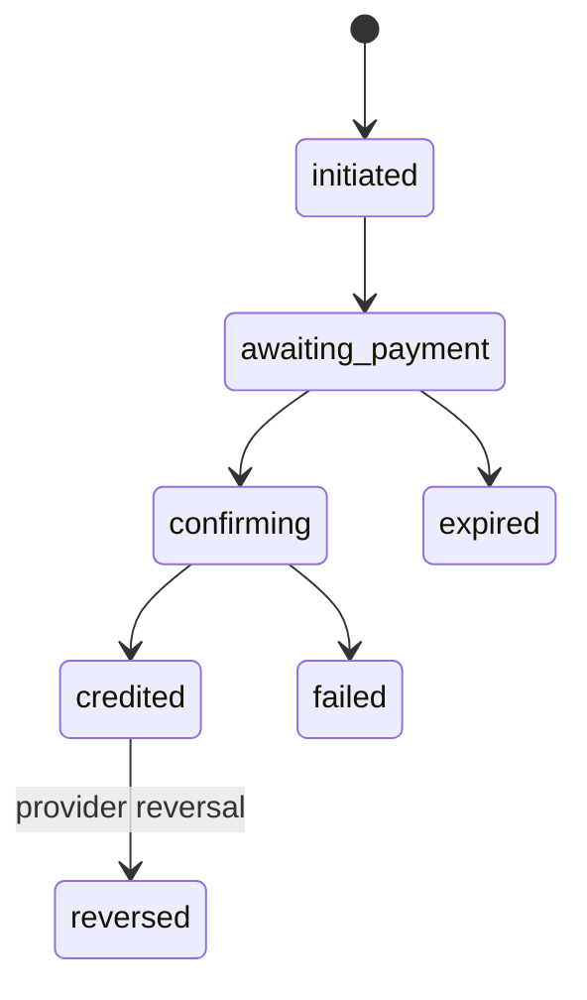
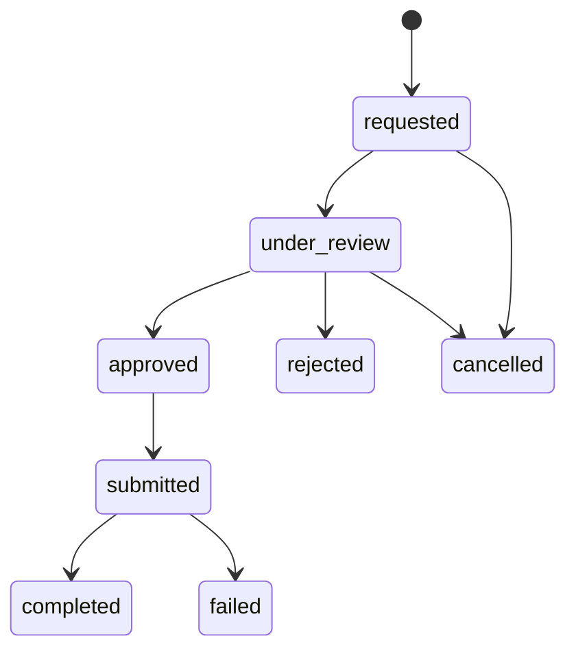
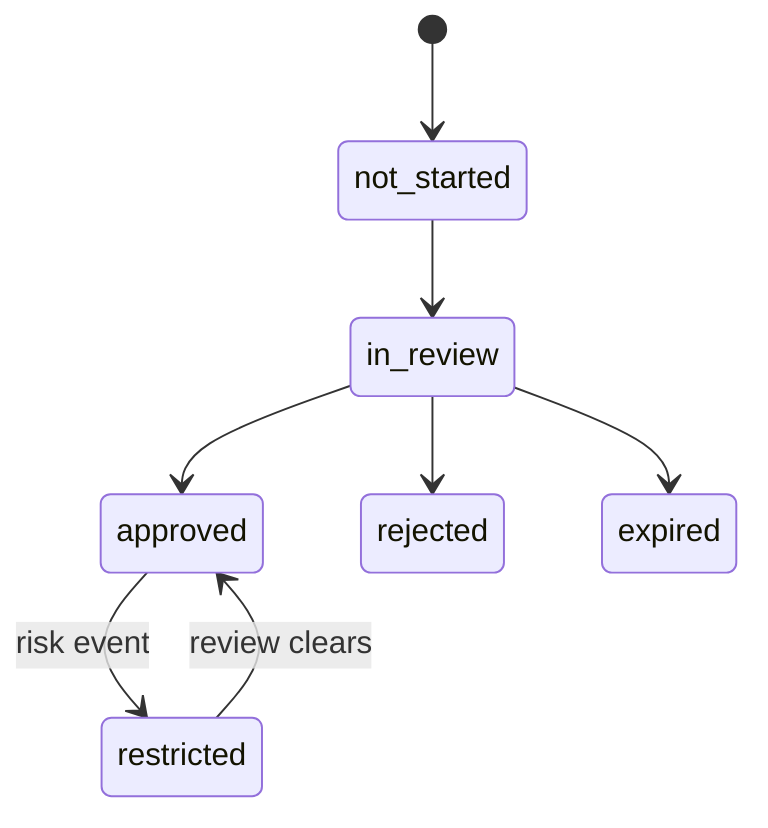
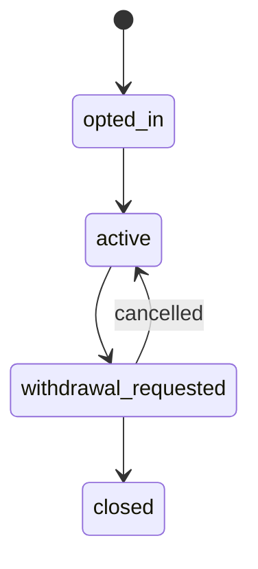
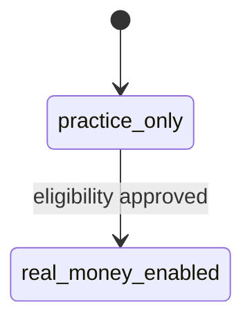
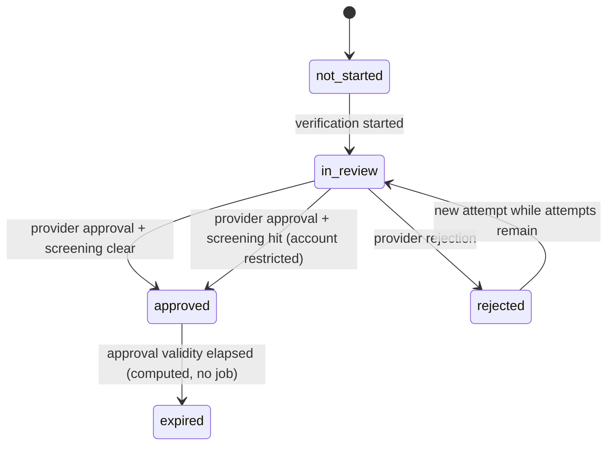
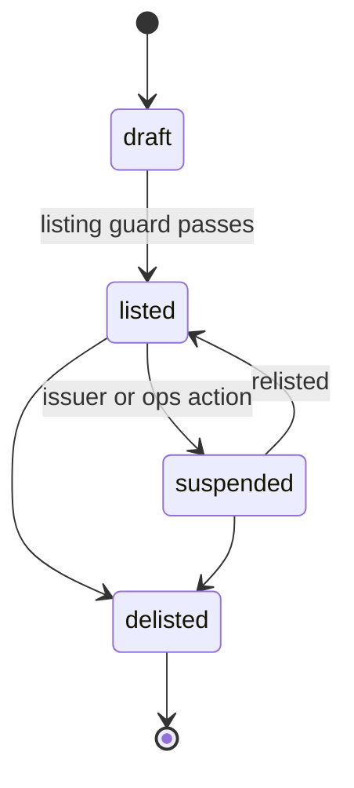
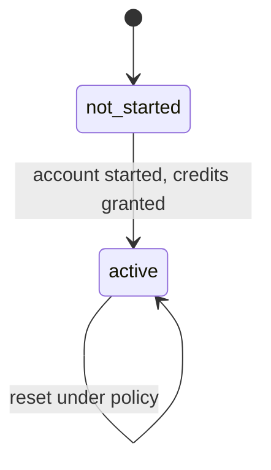
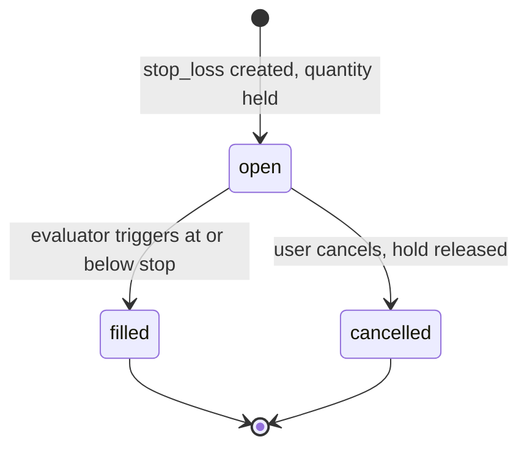

# 04. State Machines

Rule for every machine: every transition is a method on the aggregate that returns `Result`. An illegal transition returns `business.rule_violated`. Every transition writes an audit event.

## Order

Invariants: submission and execution are separate states; an expired quote never silently becomes a new trade; terminal states are `executed`, `failed`, `cancelled`.

## Deposit

Terminal: `credited` (unless reversed), `failed`, `expired`.

## Withdrawal

Terminal: `completed`, `failed`, `rejected`, `cancelled`.

## Eligibility

## Earn position

## Account mode

`real_money_enabled` is terminal in this model; demotion is handled as a restriction flow in Phase 2, not a silent flip.

## KYC verification (Compliance, Phase 2)

`kyc_status` on the compliance profile is `not_started`, `in_review`,
`approved` or `rejected`. Expiry is derived from the stored expiry time
against `TimeProvider`; there is no background job. Screening state is
`not_run`, `clear` or `hit`; a hit restricts the account for Real without
changing the KYC status.

## Identity state machines

- User: `pending_verification` to `active` on email code verification; `active` to `deletion_requested` on deletion request; `deletion_requested` to `anonymized` by the scheduled job; `active` to `disabled` by later admin tooling. `anonymized` is terminal.
- Session: created to `revoked` with a reason. Revocation is final.
- Device: created untrusted to `trusted` on first verified login or device code; `trusted` to `revoked`. Revoking a device revokes its sessions.
- One-time code: issued to `consumed` or `expired`; attempts increment atomically up to the cap. Single use.
- Step-up grant: issued to `consumed` or `expired`; 120 second life, single use.

## Catalog token (Catalog, Phase 4)

`delisted` is terminal: a returning token is a new token row. `ever_listed`
is set on first entry to `listed` and freezes the immutable fields (chain,
address, decimals, issuer, instrument, ledger asset code) forever after.
Sellers may still exit a `delisted` token when its chain is enabled and a
gateway key exists.

## Catalog issuer and instrument

- Issuer status is `approved` or `suspended` (review metadata lives on the row; expiry of the review blocks new listings, not exits).
- Instrument status is `active` or `delisted`; delisting an instrument hides it from Practice without touching token rows.

## Practice account and order (Practice, Phase 6)

The practice account has two states: `not_started` and `active`. `POST /account` moves `not_started` to `active` and grants the starting credits exactly once; a reset keeps the account `active`, zeroes every practice balance through journals and grants again under the reset policy (cooldown plus a rolling 30 day limit counted from `practice_events`).

The practice order machine is deliberately simpler than the real one: market orders fill inside the request and never persist an `open` state; stop-loss orders are `open` until triggered or cancelled. Failures are errors, not stored orders.

Phase 10's real order machine extends this shape with quote, authorization and submission states; the practice states and journal patterns carry over.
