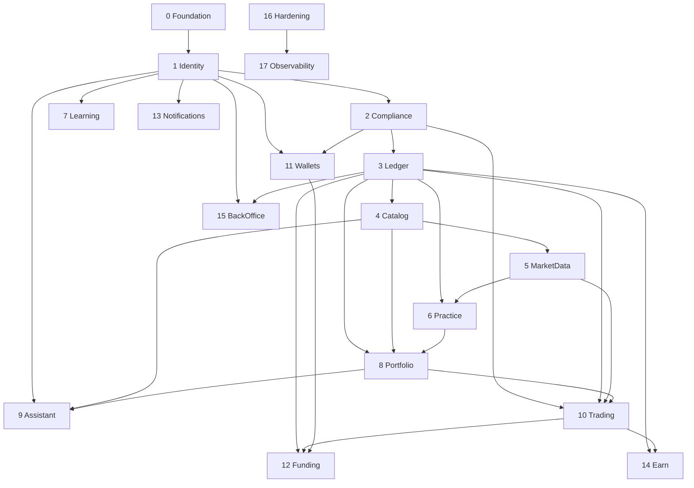

# 07. Delivery Roadmap

Phases 0 to 17. Each phase ends with the Definition of Done in `CLAUDE.md`.

| Phase | Scope | Depends on |
|---|---|---|
| 0 | Design, hardened foundation, containers, CI (this phase) | none |
| 1 | Identity and access: users, credentials, sessions, devices, PIN (done) | 0 |
| 2 | Compliance: country eligibility, KYC, consents, Practice/Real mode switch (provider interfaces and fakes only; real adapters when a provider is chosen; manual review queue stays in 15) | 1 |
| 3 | Ledger: accounts, journals, balances, outbox, Practice and Real books | 2 |
| 4 | Catalog: companies, tokens, issuers, rights and risk disclosures | 3 |
| 5 | Market data: prices, candles, freshness labels | 4 |
| 6 | Practice: virtual credits, simulated orders | 3, 4, 5 |
| 7 | Learning: lessons, quizzes, streaks | 1 |
| 8 | Portfolio: holdings, cost basis, watchlist | 3, 4, 6 |
| 9 | Assistant: AI chat, tool calls, citations, audit | 1, 4, 8 |
| 10 | Trading: quotes, real orders, order state machine | 2, 3, 4, 5, 8 |
| 11 | Wallets: custody abstraction, addresses, signing requests | 1, 2 |
| 12 | Funding: deposits, conversion, withdrawals, webhooks | 3, 10, 11 |
| 13 | Notifications: channels, alerts, preferences | 1 |
| 14 | Earn: opt-in positions, yield sources | 3, 10 |
| 15 | Back office: admin, audit log, reconciliation, feature flags | 1, 3 |
| 16 | Hardening for launch: field encryption, backup encryption, erasure flow | all product phases |
| 17 | Observability and scale: OpenTelemetry, performance, launch | all |

Post-launch track: price alerts, Stop Loss execution, Borrow, gifting, copy investing, family tools.

