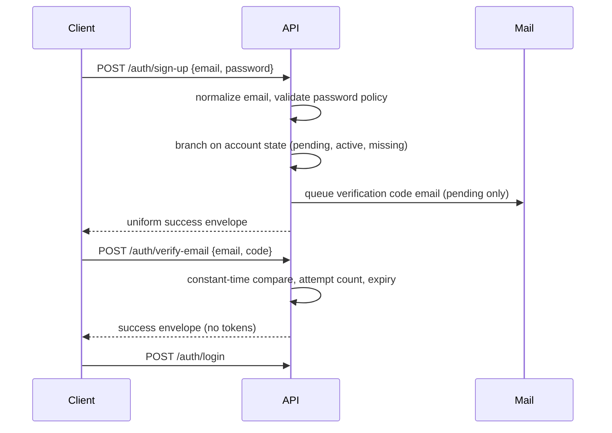
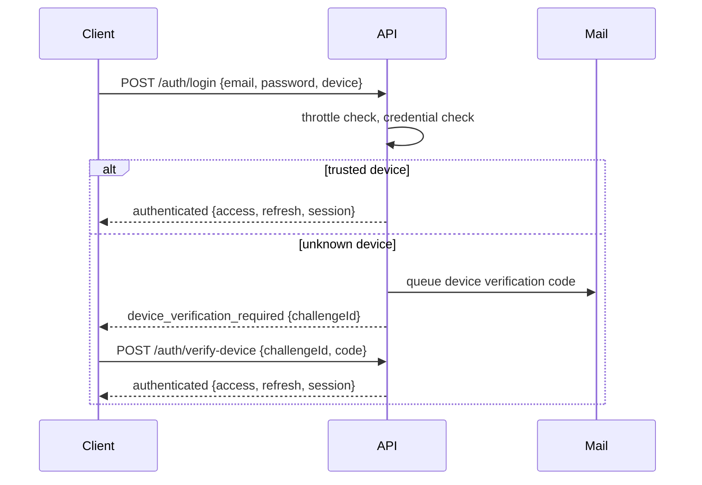
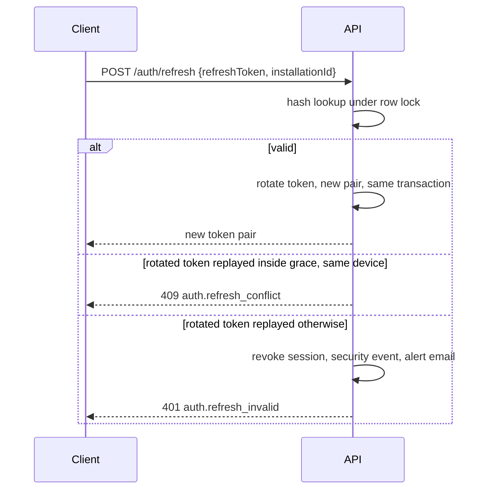
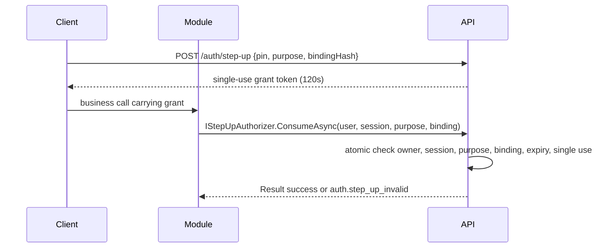

# Identity Module

Owns users, credentials, sessions, devices, one-time codes, throttling, step-up grants, security events and account lifecycle. Schema `identity`. Route prefix `/api/v1` with `/auth` and `/account` groups.

## Flows

### Sign-up and email verification

### Login with device verification

### Refresh with reuse detection

### Step-up consumption

## Data model

Tables in schema `identity`: `users`, `user_roles`, `devices`, `sessions`, `refresh_tokens`, `one_time_codes`, `throttle_buckets`, `step_up_grants`, `security_events`. Conventions per `02-data-standards.md`: UUIDv7 ids, UTC timestamps, snake_case, optimistic concurrency on mutable tables, no cross-module foreign keys. `security_events` is append only: the application role loses update and delete rights in the same migration.

## State machines

- User status: `pending_verification` to `active` on code verification; `active` to `deletion_requested` to `anonymized`; `disabled` set by later admin tooling.
- Session: created to revoked (reason recorded). No un-revoke.
- Device: untrusted to trusted on first verified login or device code; trusted to revoked.
- One-time code: issued to consumed or expired; attempts increment atomically; single use.
- Step-up grant: issued to consumed or expired; single use, 120 seconds.

## Limits

All limits from the phase specification section 4 are configurable under the `Identity` configuration section and validated at startup: token lifetimes, code lifetime and attempts, resend cooldown and hourly cap, throttle thresholds and doubling, PIN rules and lock, session cap, deletion cooling-off, password bounds.

## Contracts (namespace `AskVest.Modules.Identity.Contracts`)

- `ICurrentUserContext`: user id, session id, device id, roles for the current request.
- `IStepUpAuthorizer`: consume a grant for a purpose and optional binding hash, returns `Result`.
- `IAccountDeletionBlocker`: modules register blockers; identity calls all during deletion request.
- `IUserDirectory`: confirm a user id exists and is active.
