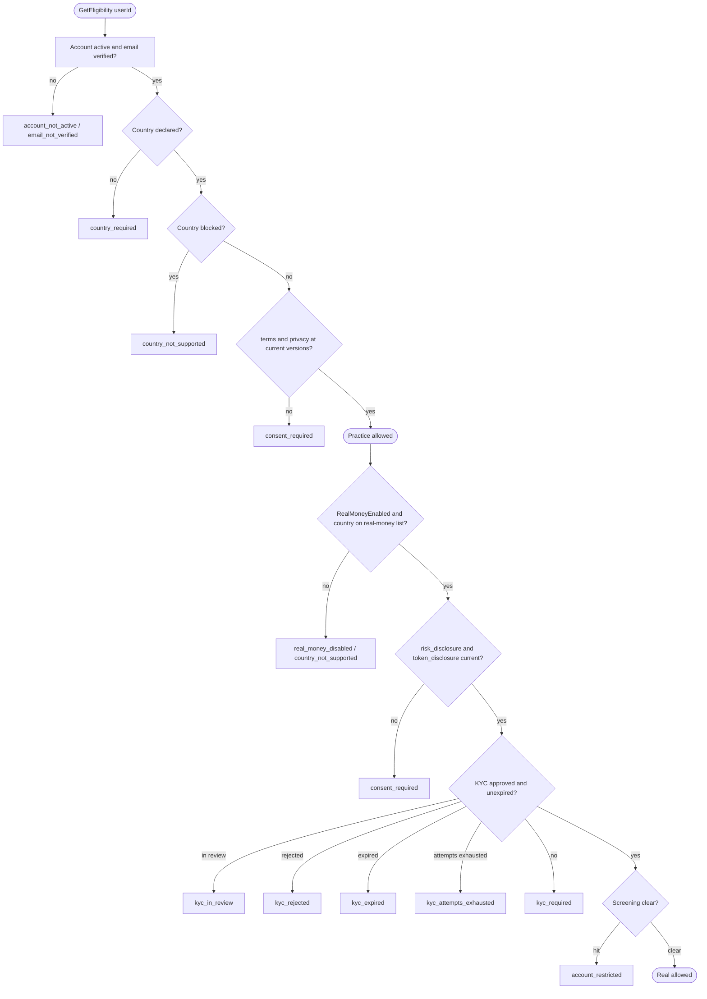
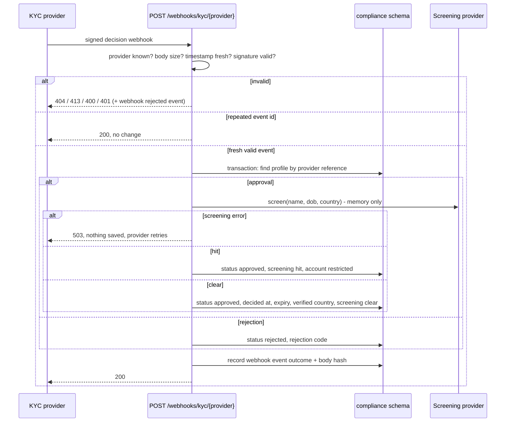

# Compliance and Eligibility (Phase 2)

Country rules, versioned consents, KYC through a provider abstraction, a
sanctions screening hook, and the eligibility gate in front of the
`/api/v1/practice` and `/api/v1/real` route groups.

The phase specification is
`AskVest-Backend-Phase-2-Compliance-and-Eligibility.md`; this document records
the decisions, the eligibility table, the configuration shape and the provider
adapter contract.

## Decisions

| Topic | Decision |
|---|---|
| Consent storage | Document definitions live in configuration (type, current version, link, SHA-256 hash of the published text, which mode requires it). Changing a version in configuration and deploying forces re-acceptance. The database stores only each user's acceptances. |
| Documents | `terms`, `privacy` (required for Practice) and `risk_disclosure`, `token_disclosure` (additionally required for Real). The token disclosure states that a token is not the underlying share and lists issuer, backing, rights and exit options. |
| Consent timing | Accepted through its own authenticated endpoint after sign-up, gating each mode. |
| Country | The user declares a country (ISO 3166-1 alpha-2). After KYC approval the provider's verified country is used instead. Rules are configuration: a blocked list (both modes denied) and a real-money-enabled list. Anything not blocked is allowed for Practice. The seed blocked list is KP, IR, SY and CU as a conservative starting point that legal must confirm before launch. The real-money list is empty in the base configuration and filled only in development and test settings. |
| Mode | Not a stored flag. Real eligibility is derived on demand from country, consents, KYC, screening and the kill switch. |
| Kill switch | A configuration flag `RealMoneyEnabled`, false by default outside development. While false, Real is blocked for everyone. |
| KYC | One level. The provider hosts the document capture, so documents and ID numbers never touch our servers or database. We store only status, provider reference, verified country, decision time, expiry, rejection code and attempt count. Approval is valid for 24 months, then reads as expired. At most 3 attempts. |
| Webhook | Signed with HMAC-SHA256 over the timestamp and the raw body using a per-provider secret, constant-time comparison, 5 minute timestamp tolerance, deduplicated by provider event id. |
| Screening | Runs when KYC approval arrives, using the name and date of birth from the webhook held in memory only. A hit marks the account restricted. If the screening provider fails, the webhook answers 503 and nothing is saved, so the KYC provider retries delivery. |
| Production guard | Startup fails if a fake provider is selected while any country is real-money-enabled outside Development and Test. |
| Module layout | Feature folders instead of the layered folders of `09-module-blueprint.md`: the file budget wins. Deviations: `Endpoints/`, `Services/`, `Persistence/`, `Providers/`, `Configuration/`, `Contracts/`, `Validation/` only as needed. |

## Eligibility

One pure, table-driven function plus the data it needs. Blockers are reported
as reason codes.

| Mode | Allowed only when |
|---|---|
| Practice | Account active with email verified (asked of Identity through `IUserDirectory`); country declared and not blocked; `terms` and `privacy` accepted at current versions |
| Real | Practice conditions hold; `RealMoneyEnabled` is true; the country (verified one if present) is on the real-money list; `risk_disclosure` and `token_disclosure` accepted at current versions; KYC approved and not expired; screening clear |

Blocker reason codes: `email_not_verified`, `account_not_active`,
`country_required`, `country_not_supported`, `consent_required` (naming the
missing document types), `real_money_disabled`, `kyc_required`,
`kyc_in_review`, `kyc_rejected`, `kyc_expired`, `kyc_attempts_exhausted`,
`account_restricted`.

The effective country is the KYC verified country when present, otherwise the
declared country.

## Route gate

Authorization policies `PracticeEligible` and `RealEligible` are applied once
at the route group level (`/api/v1/practice`, `/api/v1/real`). The
`EligibilityAuthorizationHandler` fails the request when the matching flag is
false; `ComplianceAuthorizationResultHandler` (an
`IAuthorizationMiddlewareResultHandler`) turns that failure into 403
`compliance.not_eligible` with one error detail per blocker reason code.
Missing authentication still answers the Phase 1 401. An architecture test
fails if any endpoint under `/api/v1/practice` lacks the practice policy or
any under `/api/v1/real` lacks the real policy. Two probe endpoints,
`GET /api/v1/practice/diagnostics/ping` and
`GET /api/v1/real/diagnostics/ping`, exist only when `Diagnostics:EnableProbes`
is on (never in Production) so gating can be tested over real HTTP before real
features use the groups.

## Configuration

Section `Compliance`, validated at startup:

- `Documents`: list of `{ Type, Version, Url, Sha256, RequiredFor }` where
  `RequiredFor` is `practice` or `real`. Document types must not repeat; every
  entry needs a version and a 64-char hex hash.
- `BlockedCountries`: ISO 3166-1 alpha-2 codes denied for both modes.
- `RealMoneyCountries`: ISO codes allowed for Real (empty by default).
- `RealMoneyEnabled`: kill switch, false by default.
- `Kyc`: `Provider` name, `ApprovalValidity` (24 months), `MaxAttempts` (3),
  `WebhookSecret` (at least 32 bytes).
- `WebhookTolerance`: 5 minutes.
- `Screening`: `Provider` name.

Startup fails when: document types repeat, a version or hash is missing, a
country code is invalid, a country is both blocked and real-enabled, or the
webhook secret is shorter than 32 bytes. The production guard fails startup
when a fake provider is selected while any country is real-money-enabled
outside Development and Test.

## Provider adapter contract

Any real KYC adapter must satisfy:

- `StartVerificationAsync(userId, country)` returns a provider reference and a
  session link the client opens; the provider hosts all document capture.
- `ParseWebhookAsync(rawBody, headers)` verifies the signature and timestamp
  and returns a normalized event: event id, provider reference, outcome
  (approved or rejected), rejection code, verified country, full name, date of
  birth. Personal data exists only in memory inside the webhook request.
- Webhook signature is HMAC-SHA256 over `{timestamp}.{rawBody}` with the
  per-provider secret, compared in constant time; timestamp tolerance is the
  configured window; event ids deduplicate.

Any real sanctions screening adapter must satisfy:

- `ScreenAsync(fullName, dateOfBirth, country)` returns `clear`, `hit` or
  `error` plus a provider reference. A hit restricts the account; an error
  fails the webhook so the provider retries.

The shipped fakes: `FakeKycProvider` signs webhooks with the configured secret
using headers `X-Webhook-Timestamp` and `X-Webhook-Signature` (hex
HMAC-SHA256); `FakeScreeningProvider` returns a hit when the name matches a
configured test marker.

## KYC webhook flow

## Data

Schema `compliance`: `consent_records`, `compliance_profiles`,
`kyc_webhook_events`, `compliance_events` (append only; the application role
gets no update or delete rights). No foreign keys to other modules.

Event types: consent accepted, country set, country changed, KYC started,
KYC approved, KYC rejected, screening clear, screening hit, webhook rejected.

## Contracts for other modules

`AskVest.Modules.Compliance.Contracts` exposes `GetEligibility(userId)`
(returning the flags and blockers) and `IsRealMoneyCountry(countryCode)`.
Phases 6, 10 and 12 consume them. Identity is read only through
`AskVest.Modules.Identity.Contracts.IUserDirectory`.
